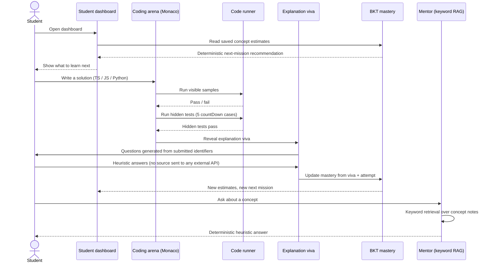
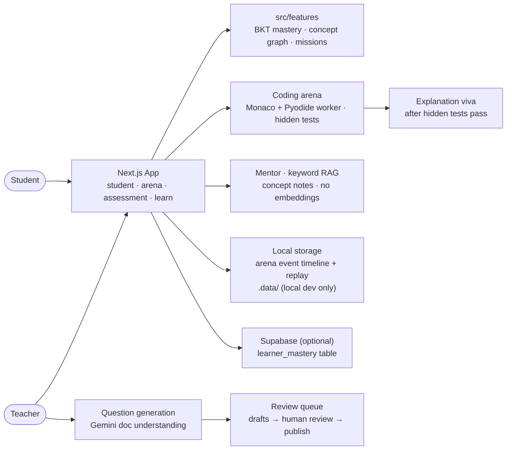

# SkillPath

**Your Skills. Your Path. Your Progress.**

SkillPath is an adaptive coding-learning workspace for students and teachers. It was built as a team hackathon project for PS2 — Adaptive Learning and Assessment Portal.

**Live demo (team deployment):** https://devkraft-black.vercel.app/

The workspace shows only saved learner and teacher activity. Empty states are used until real activity is recorded — no sample learner, class, assignment, or activity records are created automatically. The landing page shows `0+` counters until real data exists.

## What it does

**For students**

- A concept map and learning pages that show what to learn next.
- A student dashboard with saved concept estimates and a deterministic next-mission recommendation when progress exists.
- A coding arena with a Monaco editor, session replay, and an explanation viva after passing hidden tests.
- Assessments with server-served questions and server-validated scoring, tracked per concept with Bayesian Knowledge Tracing (BKT) mastery.

**For teachers**

- An assignment workspace with saved drafts, review, publishing, and honest empty analytics states.
- Question generation from pasted notes or uploaded TXT, Markdown, PDF, or PPTX material, saved as drafts for review before publishing.
- A review queue that flags arena attempts with integrity signals for human review.

## How the core loop works

A student practices, the system updates what it believes they know, and the next mission follows from that — deterministically, not from a black-box model.



Notes on the diagram, all true to the implementation:

- **Python runs locally** in a pinned Pyodide Web Worker (`public/pyodide-worker.js`). Remote execution through JDoodle or Judge0 is optional and **disabled unless explicitly configured** with server-side credentials.
- **The viva is generated from the submitted identifiers** (function and variable names in the student's own code). Heuristic answers update mastery without sending source to an external API. **No generated explanation is connected by default.**
- **The mentor is local keyword retrieval** over concept notes plus deterministic heuristics — not embeddings, not a vector database, not an LLM call.
- **RAG (first version) is keyword retrieval** over teacher material. Fine-tuning is intentionally not used: teacher material changes per course, and retrieval provides the grounding boundary.

## How it works (data flow)



Where data lives:

- **Browser local storage** — arena attempt event timelines and the replay scrubber.
- **`.data/learner-mastery/`** — assessment mastery on local development only, written after a local learner completes activity. Production requires Supabase and never treats that directory as durable storage.
- **`.data/teacher-portal/state.json`** — teacher drafts on local development only, when Supabase is not configured.
- **Supabase `learner_mastery` table** — durable mastery storage when credentials are configured (migration: `supabase/migrations/20261016000000_create_learner_mastery.sql`).
- **Anonymous learner cookie** — a local-development identity, not authentication. There is no sign-in system beyond the `/login` page surface; do not treat the cookie as an account.

## Tech stack

| Layer | Choice |
|---|---|
| Framework | Next.js 16.3.7 (App Router) · React 19.3.0 · TypeScript 5.9.3 |
| Styling | Tailwind CSS 3.4.17 · PostCSS · Autoprefixer |
| Editor | `@monaco-editor/react` 4.7.0 |
| Code execution | Pyodide Web Worker (local, pinned; Pyodide is not an npm dependency) · JDoodle / Judge0 optional, disabled by default |
| Data | `@supabase/ssr` 0.7.0 · `@supabase/supabase-js` 2.57.4 (both optional) |
| Validation | Zod 3.25 |
| UI | Framer Motion 14.3.0 · `lucide-react` 0.468.0 · Three.js 0.186.1 / `@react-three/fiber` 9.8.1 |
| Tests | Vitest 3.2.4 · `tsc --noEmit` typecheck · ESLint 9.39.0 |

No PyTorch, TensorFlow, LangChain, Pinecone, or vector database is used anywhere in this project. AI features are keyword retrieval, deterministic heuristics, and (teacher-side only) Gemini document understanding for question generation.

## What works

- Responsive landing page with student, teacher, assessment, and coding arena navigation.
- Student dashboard with saved concept estimates and a deterministic next-mission recommendation when progress exists.
- Teacher assignment workspace with saved drafts, review, publishing, and honest empty analytics states.
- Server-served assessment questions and server-validated scoring with per-concept BKT mastery saved for an anonymous browser learner.
- Monaco code editor with TypeScript, JavaScript, and Python starter snippets. The arena can run visible samples and five hidden `countDown` cases through an explicitly enabled JDoodle provider; submissions update mastery.
- Arena attempts keep an event timeline in browser local storage and show a replay scrubber with integrity signals explicitly flagged for human review.
- Passing the arena hidden tests reveals an explanation viva generated from the submitted identifiers; heuristic answers update mastery without sending source to an external API.
- Local concept-note keyword retrieval and separate deterministic mentor heuristics. No generated explanation is connected.
- Typed domain and API contracts, Supabase SSR/browser client helpers, and adaptive-learning unit tests.

## Start locally

```sh
npm install
cp .env.example .env.local
npm run dev
```

Then open `http://localhost:3000`. On Windows PowerShell, use `Copy-Item .env.example .env.local` instead of `cp`.

Local development can run without Supabase.

## Quality checks

```sh
npm run lint
npm run typecheck
npm test
npm run build
```

## Integrations and planned work

- Supabase credentials are optional. When configured, assessment mastery uses the `learner_mastery` table defined in `supabase/migrations/20261016000000_create_learner_mastery.sql`; otherwise the server writes only user-created records under the ignored `.data/` directory. The anonymous learner cookie is a local development identity, not authentication.
- JDoodle execution is disabled unless `JDOODLE_EXECUTION_ENABLED=true` and server-side credentials are present. This opts the public demo routes into potentially billable code execution; add authentication and deployment-backed rate/quota controls before enabling it on an internet-facing deployment. Judge0 remains optional and must be verified before use.
- Teacher PDF/TXT/Markdown/CSV uploads use server-only Gemini document understanding plus keyword RAG. Generated questions are Zod-validated, source-linked, saved as drafts, and publishable only after review. Supabase deployments need `GEMINI_API_KEY` and the server-only `SUPABASE_SERVICE_ROLE_KEY` for authoritative grading; without Supabase, the same workflow persists to ignored `.data/teacher-portal/state.json` for local development.
- Teacher notes can be pasted or uploaded as TXT, Markdown, PDF, or PPTX; every source uses the grounded Gemini route. Published assignments can also carry a validated visual explanation that appears as a diagram on `/learn`.
- RAG is keyword retrieval in this first version, not embeddings or a vector database. Fine-tuning is intentionally not used: teacher material changes per course and retrieval provides the grounding boundary.
- Session replay, code viva, persistent analytics, and validated adaptive-model parameters remain future work.

See [docs/ARCHITECTURE.md](docs/ARCHITECTURE.md), [docs/API_CONTRACTS.md](docs/API_CONTRACTS.md), [docs/SETUP.md](docs/SETUP.md), and [docs/TEAM_WORKFLOW.md](docs/TEAM_WORKFLOW.md).

## Project structure

```text
src/app/            Next.js pages and API routes
                    api/ · arena/ · assessment/ · learn/ · login/ · student/ · teacher/
src/components/     Landing, learning, coding, student, and teacher UI
src/features/       Adaptive learning (BKT, concept graph, missions) and assessments
src/lib/            Shared helpers (incl. Supabase SSR/browser clients)
src/config/         App configuration
src/data/           Concept notes and demo data
src/types/          Typed domain and API contracts
public/            favicon.png · js-worker.js · pyodide-worker.js
supabase/          SQL migrations for durable storage
docs/              Architecture, API contracts, setup, and team workflow
```

## Honest limits

- **No real authentication.** The anonymous learner cookie is a local-development identity, not an account system.
- **No sample data.** Every surface shows honest empty states until real learner or teacher activity is recorded.
- **No remote code execution on the live demo.** JDoodle and Judge0 are disabled unless explicitly configured with server-side credentials; Python runs locally in the browser via Pyodide.
- **No embeddings, vector database, or fine-tuning.** RAG is keyword retrieval; the mentor is deterministic heuristics.
- **No generated explanations connected by default.** The viva is generated from submitted identifiers with heuristic answers.
- **No persistent analytics yet.** Session replay, code viva, persistent analytics, and validated adaptive-model parameters remain future work.
- **Supabase is optional and local-first.** Without it, mastery and teacher state live in the ignored `.data/` directory, which is not durable storage.

## Team

Built by a team. Initial ownership areas, from `docs/TEAM_WORKFLOW.md`:

- Aman Shejul — frontend and integration
- Swapnil Thite — backend and execution
- Pankaj Dandekar — assessments, adaptive missions, and QA
- Yash Ambekar — AI mentor, RAG, and viva

This repository is an imported copy of the original team repository, [AmanShejul/devkraft](https://github.com/AmanShejul/devkraft). Commit history is preserved from the original.
